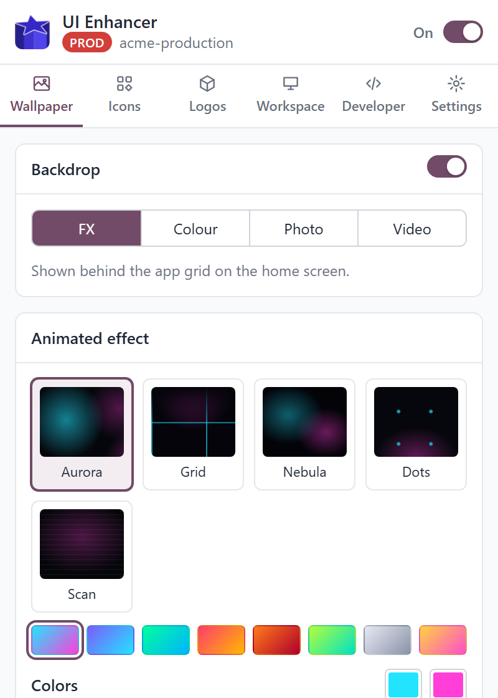
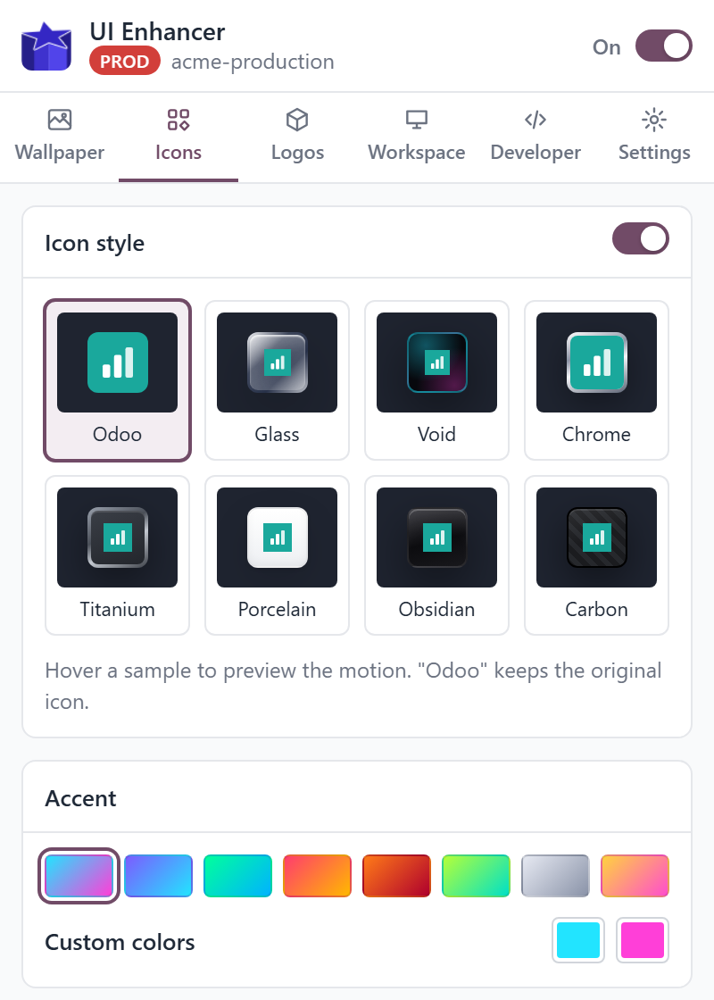
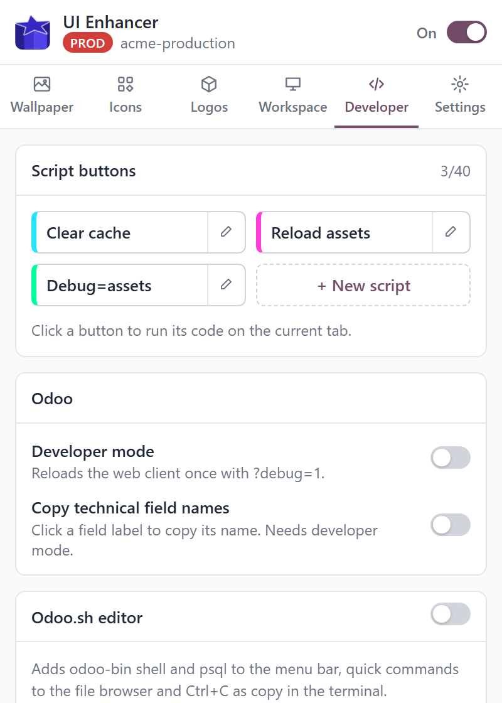

# UI Enhancer for Odoo

A Chrome extension that restyles the Odoo home menu and adds a few developer
conveniences, including tools for the Odoo.sh online editor. Works on Odoo 16
to 19 and on JupyterLab 3 and 4 (the Odoo.sh editor).

**Everything is off by default.** A fresh install changes nothing: the master
switch, and every feature behind it, start disabled. Appearance is stored per
domain, so each project can look different.

<p align="center">
  
  
  
</p>

## Features

**Backdrop** - animated effects (aurora, synth grid, nebula, dots, scanlines)
in any two colours, a plain colour or gradient, a photo (link, upload or a
linked local folder) or a looping video, with darkening and blur.

**Icons** - frame styles (liquid glass, void, chrome, titanium, porcelain,
obsidian, carbon, or Odoo's own), smooth hover motion (levitate, magnet, tilt,
focus, glide), a boot animation, shape, artwork size, and caption colour,
size and font. Samples in the popup use the exact CSS the page gets.

**Logos** - any number of logos over any backdrop, placed with sliders.

**Workspace** - PROD / STAGING / DEV badge, hide the Odoo.sh trial notice and
the neutralised-database banner. Non-Odoo hosts (localhost, internal domains)
can be enabled one address at a time.

**Developer** (hidden until switched on in Settings)
- Developer mode (`?debug=1`) applied automatically.
- Click a field label to copy its technical name.
- Script buttons: give a button a name, a colour and some JavaScript. A click
  runs it on the current tab in the page context, like the DevTools console.
- Odoo.sh editor: `odoo-bin shell` and `psql` in the menu bar; right-click a
  folder for zip, install (`-i`) or update (`-u`); right-click a `.zip` to
  unzip; Ctrl+C copies selected text in the terminal instead of sending SIGINT.

## Install (unpacked)

1. Open `chrome://extensions` and enable Developer mode.
2. Click "Load unpacked" and pick this folder.
3. Open the popup and switch the extension on.

## Layout

```
manifest.json
_locales/            Chrome manifest strings
assets/icons/
src/
  background/        service worker: custom-host registration, toolbar icon
  content/           content script, split by feature, wired in index.js
  page/              editor-bridge.js, runs in the page's main world
  popup/             popup UI (store, ui kit, panels)
  shared/            defaults, icon/badge CSS generators, i18n
```

The content script modules share the `OstContent` namespace and load in the
order listed in `manifest.json`, which the service worker reuses for custom
hosts. The popup follows the same pattern with `OstPopup`.

## Security notes

- The editor bridge accepts only a fixed set of command shapes, and every
  folder name is shell-quoted before it reaches the terminal.
- Script code is stored by the extension and run by the service worker only
  on a request from the popup; web pages cannot trigger it.
- Only extension pages can register a custom domain, and permission is
  requested for that single origin, never for all sites.

## License

Proprietary, personal use only. See [`LICENSE.md`](./LICENSE.md).
